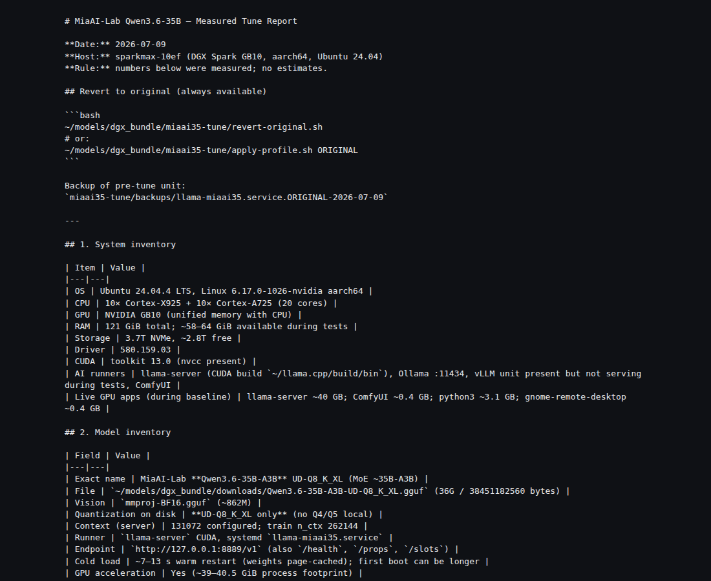

# miaai35-tune



Measured **llama.cpp** tune for **Qwen3.6-35B-A3B** on NVIDIA DGX Spark.

Not a from-scratch train — a flag/profile bakeoff with real tok/s, TTFT, quality, and VRAM numbers.

## At a glance

| | |
|---|---|
| **What it is** | A measured **llama.cpp** flag/profile bakeoff for **Qwen3.6-35B-A3B** on NVIDIA DGX Spark — benches, profiles, and a written report with real tok/s / TTFT / quality / VRAM numbers. |
| **What it’s for** | So you can pick serving settings with **evidence**, not vibes — and reproduce (or challenge) the numbers we got on Spark unified memory. |
| **How to use it** | Numbers: [`RESULTS.md`](RESULTS.md). Method: [`REPORT.md`](REPORT.md). Or `./setup.sh` then point `bench_v5.py` at any OpenAI-compatible `llama-server`. Weights stay local. For a known-good Spark serve path, see [MiaAI Labs’ Qwen3.6-35B recipe](https://github.com/MiaAI-Lab/Qwen3.6-35B-A3B-UD-Q8_K_XL_DGX-Spark-Recipe). |

## Try it (pick one)

### One command
```bash
git clone https://github.com/Coinupbtc/miaai35-tune.git
cd miaai35-tune && ./setup.sh
```

### Copy-paste
```bash
git clone https://github.com/Coinupbtc/miaai35-tune.git && cd miaai35-tune
python3 -m venv .venv && .venv/bin/pip install -r requirements.txt
# with a local server already on :8889
./.venv/bin/python bench_v5.py --base http://127.0.0.1:8889 --tag local
```

### Just read the results
**Source of truth:** [`RESULTS.md`](RESULTS.md). Lab log: [`REPORT.md`](REPORT.md).

## Public hero (this repo is the single public figure)

**35.80 tok/s** — copy this onto homepage / profile. Same-file band **~35–38** (35.29–38.23).

| | |
|---|---|
| **Number** | **35.80 tok/s** |
| Same-file band | 35.29–38.23 tok/s (**~35–38**) |
| File | [`results/bench-original-rerun-think-off-20260709-203311.json`](results/bench-original-rerun-think-off-20260709-203311.json) |
| Field | `results[]` `"test": "coding"` → `tokens_per_sec` = `35.8` (`timings.predicted_per_second` = 35.8028…) |
| Conditions | ORIGINAL, thinking off, clean restart, UD-Q8_K_XL, no spec decode |
| **Do not use** | **169 t/s** (not in committed JSON) |

Canonical copy sheet: [`RESULTS.md`](RESULTS.md). Do not pull a second number from REPORT addenda.

| Metric | Measured | Source |
|--------|----------|--------|
| **Hero — coding decode** | **35.80 tok/s** | file above |
| Same-run suite (short / reason / long) | 38.23 / 35.29 / 35.45 tok/s | same file |
| Coding suite | 9/10 quality | same file |
| Short TTFT | 0.26 s coding / 0.41 s short | same file |
| Long TTFT (~9.5k tok) | 7.56 s | same file |
| VRAM (BALANCED) | 39510 MiB | [`results/bench-balanced-final-think-off-20260709-204018.json`](results/bench-balanced-final-think-off-20260709-204018.json) |

Biggest interactive win: client `enable_thinking=false`.

## Layout

| Path | What |
|------|------|
| `RESULTS.md` | **Public hero** — one tok/s number, JSON file path |
| `REPORT.md` | Full measured report |
| `profiles/` | llama-server profiles (BALANCED, MAX_SPEED, …) |
| `bench_*.py` / `stress_test.py` | Harnesses |
| `results/` | JSON from real runs |
| `setup.sh` | One-command env setup |

Weights are **not** in this repo (multi-GB). Use your own UD-Q8_K_XL (or similar) GGUF with `llama-server`.

## Acknowledgments

Serving baseline for this tune: [MiaAI Labs’ Qwen3.6-35B UD-Q8_K_XL DGX Spark recipe](https://github.com/MiaAI-Lab/Qwen3.6-35B-A3B-UD-Q8_K_XL_DGX-Spark-Recipe) ([MiaAI-Lab](https://github.com/MiaAI-Lab)). This repo is our measured flag/profile bakeoff on top of that recipe — not a general endorsement, and not related to our other projects.


## License

MIT
